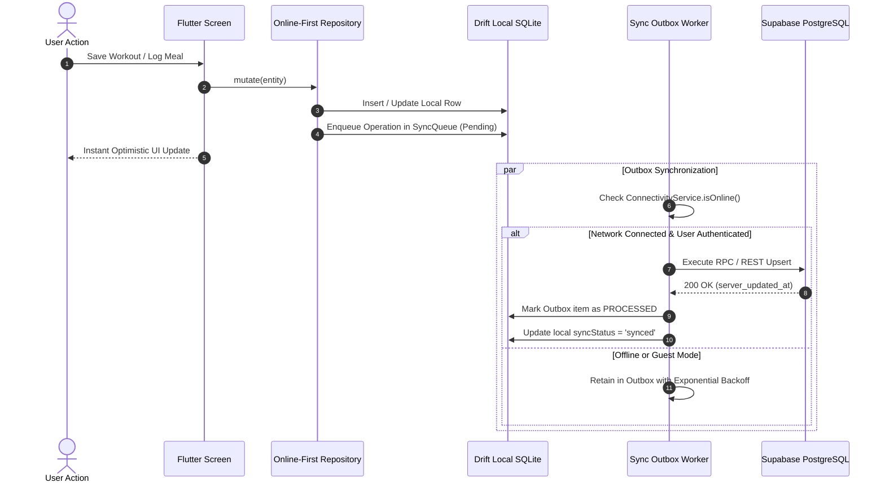

# Fit Host — System Blueprint, Feature Architecture & Project History

> **Platform**: Native Flutter Mobile (Android & iOS) + Next.js 16 Production Web Platform  
> **Database & Auth**: Supabase PostgreSQL (Row Level Security) + Drift SQLite (Offline-First Local Cache)  
> **Production Domain**: [https://fithost.amitrana.tech](https://fithost.amitrana.tech)  
> **Canonical Repository**: `/Users/amitrana/fit-host`  
> **Generated Timestamp**: 2026-10-21  

---

## 1. Executive Summary & Product Mission

**Fit Host** is a fitness and wellness ecosystem designed to bridge local device performance with cloud-backed reliability. Engineered with Flutter and Riverpod for mobile, Supabase and PostgreSQL for cloud state and identity, and Next.js 16 on Vercel for public discovery and web administration, Fit Host delivers a high-performance experience without forcing users to register before experiencing value.

### Core Architecture Pillars:
1. **Guest-First & Hybrid Online Persistence**: Users can launch the app immediately in Guest Mode with zero friction. All workouts, meals, hydration, and settings persist locally to encrypted Drift SQLite. Upon authenticating via Supabase (Email/Password, 6-digit OTP, or Google OAuth), an atomic data claim worker seamlessly migrates all guest assets to the cloud.
2. **Unified Exercise & Routines Engine**: A catalog of 1,324+ curated, deduplicated exercises (derived from CC-BY-SA and public domain sources) mapped to primary/secondary muscle groups, equipment, and gender-inclusive anatomical models. Includes a workout engine with supersets, target RPE, rest timers, and progressive overload calculations.
3. **Multi-Source Health Intelligence**: Dual-pipeline step counting (Hardware Pedometer fallback + HealthKit / Health Connect), intelligent nutrition tracking (ICMR-NIN Indian food database, USDA FoodData Central API, OpenFoodFacts barcode scanner, and Gemini AI natural language meal parsing), and 2-way Google Calendar synchronization.
4. **Resilient System Alarms & Reminders**: Native exact alarms (`SCHEDULE_EXACT_ALARM`) that ring through lock screens and app termination, with custom device audio selection, wake-locks, and smart snoozing.
5. **Production Next.js Platform & Email Studio**: A responsive public website hosted on Vercel featuring Dynamic Releases (auto-synced with GitHub Releases API), interactive iPhone mockups, deep-linked auth callbacks, and a Resend Email Hub with 50+ templates.

---

## 2. High-Level System Architecture Blueprint

```
+---------------------------------------------------------------------------------------+
|                                    FIT HOST ECOSYSTEM                                  |
+---------------------------------------------------------------------------------------+
                                           |
         +---------------------------------+---------------------------------+
         |                                                                   |
         v                                                                   v
+----------------------------------+                       +----------------------------------+
|    FLUTTER CLIENT APPLICATION     |                       |    NEXT.JS 16 WEB PLATFORM       |
|    (Android 14+ / iOS 17+)       |                       |    (https://fithost.amitrana.tech)|
+----------------------------------+                       +----------------------------------+
| - State: Riverpod 2.6            |                       | - Framework: React 19 / App Dir  |
| - UI: Apple Dark Glow Aesthetic  |                       | - Styling: Tailwind CSS v4       |
| - Local DB: Drift SQLite (v4)    |                       | - Deploy: Vercel Edge CDN        |
| - Exact Alarms & Audio Service   |                       | - GitHub Releases Auto-Sync API  |
| - HealthKit & Health Connect API |                       | - Resend Email Studio (50 Tpls)  |
| - Google Calendar OAuth Client   |                       | - Protected Supabase SSR Auth    |
+----------------------------------+                       +----------------------------------+
         |                                                                   |
         |                 HTTPS / WSS / JWT Session Cookies                 |
         +---------------------------------+---------------------------------+
                                           |
                                           v
                        +-------------------------------------+
                        |          SUPABASE BACKEND           |
                        | (https://eedubttdylyqrhyeikwb...)  |
                        +-------------------------------------+
                        | - Auth: GoTrue (Email, OTP, Google) |
                        | - Database: PostgreSQL 15.1         |
                        | - Security: Row Level Security (RLS)|
                        | - Storage: Progress Photos / Media  |
                        | - Realtime: Sync Outbox Drain Gate  |
                        +-------------------------------------+
                                           |
         +---------------------------------+---------------------------------+
         |                                 |                                 |
         v                                 v                                 v
+------------------+             +-------------------+             +-------------------+
|  GOOGLE APIS &   |             |  USDA FOODDATA    |             |   RESEND EMAIL    |
|  GEMINI AI       |             |  & OPENFOODFACTS  |             |   DELIVERY HUB    |
+------------------+             +-------------------+             +-------------------+
| - Google Cal API |             | - Food search API |             | - Transactional   |
| - Gemini 1.5/2.0 |             | - Barcode scanner |             |   verification    |
|   Meal Analysis  |             | - Nutrition calc  |             | - 50 system tpls  |
+------------------+             +-------------------+             +-------------------+
```

---

## 3. Data Synchronization & Hybrid Persistence Layer

Fit Host employs a robust **Hybrid Local-Cache / Cloud-Authoritative Architecture**:



### Guest-to-Account Migration Lifecycle
When a user begins as a guest, their records in Drift are tagged with `user_id = 'guest'`. When they register or sign in via Supabase:
1. `GuestAccountClaimService.claimGuestData(newUserId)` triggers an atomic transaction.
2. Local Drift records across `workouts`, `workout_exercises`, `workout_sets`, `food_items`, `meal_logs`, `water_logs`, `sleep_logs`, `reminders`, `diary_entries`, `body_measurements`, and `progress_photos` are updated from `guest` to `newUserId`.
3. Outbox worker enqueues all unclaimed records to push them to the cloud.
4. Remote Supabase records for that user are fetched and merged locally using timestamp arbitration (`updated_at > server_updated_at`).

---

## 4. Comprehensive Feature Specifications

### 4.1 Onboarding & Setup Wizard
- **12-Step Progressive Wizard** ([fitness_setup_wizard_screen.dart](file:///Users/amitrana/fit-host/lib/features/profile/presentation/screens/fitness_setup_wizard_screen.dart)):
  - Captures Gender, Age, Height, Weight, Primary Goal (Muscle Hypertrophy, Fat Loss, Endurance, General Health), Target Weight, Weekly Workout Frequency, Activity Level, Dietary Restrictions (Vegetarian, Vegan, Non-Veg, Keto), Daily Calorie Target, Daily Water Target, and Daily Step Target.
  - Automatically calculates BMR (Basal Metabolic Rate) and TDEE (Total Daily Energy Expenditure) using the Mifflin-St Jeor formula with activity multipliers.
  - Generates custom personalized macro splits (Protein, Carbs, Fats).
  - Persists drafts securely using `SharedPreferences` and `FlutterSecureStorage` so accidental app closure retains user inputs.

### 4.2 Unified Exercise Catalog & Advanced Workout Engine
- **1,324+ Unified Exercises** ([unified_exercise_catalog_data.dart](file:///Users/amitrana/fit-host/lib/features/workouts/data/datasources/unified_exercise_catalog_data.dart)):
  - Built from curated datasets (`wger` and `exercises-dataset`) with explicit CC-BY-SA and public domain compliance.
  - Categorized across 12 muscle groups (Chest, Back, Shoulders, Biceps, Triceps, Quads, Hamstrings, Glutes, Calves, Abs, Forearms, Neck) and 10 equipment types (Barbell, Dumbbell, Cable, Machine, Bodyweight, Kettlebell, Resistance Band, Smith Machine, Plate, None).
  - Gender-adaptive views (Male, Female, Universal anatomy filters) ensuring relevant anatomical targeting.
- **Advanced Routine Builder & Active Workout Tracker**:
  - Structured routines with custom exercises, sets, target reps, target weight (kg/lbs), rest intervals, RPE (Rating of Perceived Exertion), and superset grouping.
  - Rest timer with audio countdown chimes and background notification alerts.
  - 1RM (One Rep Max) calculation using Brzycki and Epley formulas with real-time progressive overload recommendations.
  - Active workout state recovery: if the app is killed mid-workout, the session resumes seamlessly upon restart.

### 4.3 Advanced Nutrition & AI Meal Logging
- **Multi-Source Food Database**:
  - **ICMR-NIN Indian Food Database**: Standardized Indian meals and serving sizes (e.g., katori of dal, rotis, parathas, paneer, biryani, idli, dosa).
  - **USDA FoodData Central API**: Integrated through a secure backend proxy (`/api/nutrition/search`) to avoid exposing API keys in mobile binaries.
  - **OpenFoodFacts Barcode Scanner**: Mobile camera scanner mapping international barcodes to macronutrient profiles.
  - **Gemini AI Natural Language Parser** ([gemini_nutrition_service.dart](file:///Users/amitrana/fit-host/lib/features/nutrition/data/services/gemini_nutrition_service.dart)): Allows users to describe meals in natural language (e.g., *"2 rotis with 1 bowl of dal and 150g curd"*), returning parsed ingredients, portions, and macros with sanity clamps (e.g., pure fat max 900 kcal/100g).
- **Radial Macro Gauges & Meal Tracking**:
  - Real-time visualization of daily calories consumed vs. burned vs. net target.
  - Breakdown across Breakfast, Lunch, Dinner, and Snacks.
  - Water intake logger with quick-add increments (250ml, 500ml) and daily progress ring.

### 4.4 Accurate Activity Engine & Step Counter
- **Triple-Arbitrated Step Engine** ([step_service.dart](file:///Users/amitrana/fit-host/lib/features/steps/data/step_service.dart)):
  - Abstracted health integration layer querying **HealthKit** on iOS and **Health Connect / Google Fit** on Android.
  - Hardware device pedometer listener (`Pedometer.stepCountStream`) fallback when system health APIs are unconfigured or denied.
  - Zero double-counting arbitration: calculates baseline offsets at midnight and preserves daily step history across device reboots.

### 4.5 Responsive Fitness Calendar & Google Calendar Sync
- **Unified Event Timeline** ([calendar_screen.dart](file:///Users/amitrana/fit-host/lib/features/calendar/presentation/screens/calendar_screen.dart)):
  - View workouts, meal logs, water goals, and scheduled sessions in Day, Week, and Month views.
  - Multi-day range aggregations computing averages, distance walked, calories burned, and active streaks.
- **Two-Way Google Calendar Synchronization** ([google_calendar_service.dart](file:///Users/amitrana/fit-host/lib/features/calendar/data/services/google_calendar_service.dart)):
  - Direct OAuth2 integration using Google Calendar API v3 (`calendar.events` scope).
  - Exports scheduled workouts with custom reminder alarms directly into the user's primary Google Calendar.
  - Employs deterministic `iCalUID` generation to prevent duplicate event creation across sync cycles.

### 4.6 Native Exact Alarms, Reminders & Lock-Screen Overlays
- **Exact Alarms & Audio Control** ([permission_service.dart](file:///Users/amitrana/fit-host/lib/core/services/permission_service.dart), [fullscreen_alarm_screen.dart](file:///Users/amitrana/fit-host/lib/features/reminders/presentation/screens/fullscreen_alarm_screen.dart)):
  - Uses Android `SCHEDULE_EXACT_ALARM` and `USE_FULL_SCREEN_INTENT` with wake-locks to wake the screen over lock screens.
  - Custom audio sound selector: allows selecting device ringtones or bundled sound chimes (`sound_cyber_chime.wav`).
  - Alarm lifecycle: ringing loops for 60 seconds with configurable snooze intervals (5m, 10m, 15m) and persistent completion tracking ("Completed for today").

### 4.7 Progress Gallery & Body Measurements
- **Measurement Tracking** ([body_measurements_screen.dart](file:///Users/amitrana/fit-host/lib/features/progress/presentation/screens/body_measurements_screen.dart)):
  - Log weight, body fat %, and tape measurements (waist, chest, hips, arms, thighs, calves, neck, shoulders).
  - Automatic computation of deltas against baseline measurements ([measurement_delta.dart](file:///Users/amitrana/fit-host/lib/features/progress/domain/models/measurement_delta.dart)).
- **Progress Photo Gallery** ([progress_gallery_screen.dart](file:///Users/amitrana/fit-host/lib/features/progress/presentation/screens/progress_gallery_screen.dart)):
  - Photo classification by pose type: Front, Side, Back, Detail/Other.
  - Side-by-side visual photo comparison slider to visually evaluate body transformation over time.

### 4.8 Daily Diary & Health Intelligence
- **Reflective Diary** ([daily_diary_screen.dart](file:///Users/amitrana/fit-host/lib/features/diary/presentation/daily_diary_screen.dart)):
  - Mood selector, workout notes, daily energy rating, and integrated voice memos with local audio recording.
  - Health data export: JSON and CSV format downloads for GDPR/CCPA data portability ([health_export_service.dart](file:///Users/amitrana/fit-host/lib/features/settings/data/health_export_service.dart)).

### 4.9 Production Next.js Web Platform (`fithost.amitrana.tech`)
- **Next.js 16 App Router & Vercel Edge**:
  - High-converting landing page, interactive features showcase, guides library, support center, and legal policies.
  - Dynamic iPhone Mockup with realistic `37/76` aspect ratio, smooth bezel radius, and metallic frame lighting.
  - Real-time GitHub Releases integration: fetches latest APK assets, release notes, and version tags automatically.
- **Email Studio & Resend Hub** (`/admin/email`):
  - 50+ enterprise HTML/CSS transactional email templates (welcome, password reset, streak warnings, weekly summaries, workout milestones).
  - Live email previewer, variable injector, and direct test-send triggers via Resend API.

---

## 5. Implementation & Directory Map

```
fit-host/
├── lib/
│   ├── core/
│   │   ├── auth/                      # Auth state machine & deep link listener
│   │   ├── connectivity/              # Cross-platform online/offline listener
│   │   ├── data/                      # Online-first abstract repository interfaces
│   │   ├── database/                  # Drift SQLite schema (database.dart, tables.dart)
│   │   ├── router/                    # GoRouter navigation & auth redirects
│   │   ├── services/                  # Notification, Permission, and Audio services
│   │   ├── sync/                      # SyncCoordinator, SyncOutboxWorker, retry loops
│   │   └── theme/                     # Electric Neon Green & Cyan Dark theme tokens
│   ├── features/
│   │   ├── auth/                      # Login, Register, OTP, Forgot Password screens
│   │   ├── calendar/                  # Calendar grid, Range aggregations, Google Sync
│   │   ├── diary/                     # Daily notes, mood tracker, voice memos
│   │   ├── home/                      # Dashboard hero card, streak strip, quick actions
│   │   ├── nutrition/                 # Food search, Barcode scanner, Gemini AI parser
│   │   ├── onboarding/                # Splash screen, Welcome tour, 12-step wizard
│   │   ├── profile/                   # User profile, setup wizard, avatar picker
│   │   ├── progress/                  # Body measurements, photo gallery & compare
│   │   ├── reminders/                 # Alarms screen, Full-screen lock popup, Sound settings
│   │   ├── settings/                  # Privacy export, User manual, Notification permissions
│   │   ├── shell/                     # Floating pill bottom navigation shell
│   │   ├── steps/                     # Pedometer, HealthKit/Connect step controller
│   │   └── workouts/                  # 1,324 exercise catalog, Routine builder, Active tracker
│   └── main.dart                      # App entrypoint, ProviderScope initialization
│
├── website/
│   ├── src/
│   │   ├── app/
│   │   │   ├── (public)/              # Home, /features, /how-it-works, /about, /download
│   │   │   ├── admin/email/           # Resend Email Studio & 50 template library
│   │   │   ├── api/                   # Nutrition proxy, GitHub revalidate webhooks
│   │   │   ├── auth/                  # PKCE OAuth callback route & password recovery
│   │   │   └── dashboard/             # Authenticated user web portal
│   │   ├── components/                # Futuristic iPhone Mockup, Navbar, Footer
│   │   └── lib/                       # Supabase client/server/proxy, releases config
│   ├── public/                        # High-res screenshots, brand assets, category packs
│   └── vercel.json                    # Edge headers, cache rules, CSP configuration
│
├── supabase/
│   └── migrations/
│       ├── 20261016000000_hybrid_data_layer.sql
│       ├── 20261016000001_calendar_day_summaries.sql
│       ├── 20261016000002_calories_burned.sql
│       ├── 20261016000003_food_items_and_breakdown.sql
│       ├── 20261016000005_wizard_expansion.sql
│       ├── 20261021000000_unified_exercise_catalog.sql
│       ├── 20261021000001_advanced_workout_routines_engine.sql
│       └── 20261021000002_progress_gallery_body_measurements.sql
│
└── test/
    ├── unit/                          # 43 unit test suites (161+ tests passed)
    └── widget/                        # Widget tests & UI constraint verifications
```

---

## 6. Complete Chronological Project History & Chat Transcripts

### Session 1: Foundation Architecture, Local Persistence & Brand Identity
- **Scope**: Project initialization, offline SQLite data layer, dark theme design system, asset management.
- **Key Milestones Achieved**:
  - Configured Drift SQLite database with migrations supporting offline CRUD operations.
  - Cropped and categorized 137 high-res fitness visual assets across workouts, exercises, anatomy, and nutrition.
  - Implemented the 12-step personalized onboarding flow with draft persistence.
  - Established the near-black (`#0A0F0D`) and electric neon green (`#39FF88`) visual identity.

---

### Session 2: App Feature Updates, Online-First Supabase Auth & Web Platform Launch
- **Timeline**: 2026-10-18 to 2026-10-21
- **User Directives & Iterative Problem Solving**:
  1. *Alarm & Reminder System Overhaul*:
     - User requested: Alarm ringing for 1 minute like a real clock, repeating at custom intervals, early completion marking ("Completed for today"), device audio file selection, and full-screen lock-screen popups.
     - Solution: Implemented `PermissionService` (Android 13+ `POST_NOTIFICATIONS`, Android 12+ `SCHEDULE_EXACT_ALARM`, and battery optimization bypass), wake-lock intent handling in `FullscreenAlarmScreen`, and device audio selection.
  2. *Android UI RenderFlex Constraint Emergencies*:
     - Critical bug: Physical Android devices suffered RenderFlex overflow errors on text rows, alarm popups, and the home workout card.
     - Solution: Systematically audited layouts, wrapped text in `Expanded`/`Flexible` with ellipsis handling, resolved `Wrap` layouts on header actions, and validated with `flutter analyze` (0 issues).
  3. *Online-First Supabase Authentication & Guest Migration*:
     - User directive: Transition away from "offline-first" public positioning to "online-first with resilient local cache". Maintain guest mode without mandatory signup, but upon login (Email/Password, 6-digit OTP, or Google OAuth), automatically migrate local guest data to Supabase.
     - Solution: Replaced all public "offline-first" copy; created `GuestAccountClaimService`; deployed Supabase migration `20261016000000_hybrid_data_layer.sql` with RLS; configured Android and iOS deep link schemes (`io.supabase.fithost://login-callback`).
  4. *Next.js 16 Web Platform Deployment on Vercel*:
     - Built and deployed `https://fithost.amitrana.tech` with public routes (`/`, `/features`, `/how-it-works`, `/download`, `/updates`, `/guides`, `/support`, `/privacy`, `/terms`).
     - Fixed Tailwind CSS v4 PostCSS styling issues, integrated Supabase SSR cookie authentication proxy, and configured Vercel security headers.
  5. *Futuristic iPhone Device Mockups*:
     - Refactored web screenshots into high-fidelity titanium iPhone mockups adhering to the exact `aspect-ratio: 37/76` proportion with subtle glass reflections and notch removal.
  6. *Automated GitHub Releases Pipeline*:
     - Wired Next.js to the GitHub REST API (`GET /repos/{owner}/{repo}/releases`) to dynamically present latest version tags, release dates, release notes, and APK download buttons with ISR caching and fallback.
  7. *Google Calendar, Step Engine & Nutrition Platform Upgrade*:
     - Implemented `GoogleCalendarService` for 2-way event syncing with custom iCalUIDs.
     - Created `HealthPlatformService` to unify HealthKit and Health Connect with zero duplicate counting.
     - Expanded the nutrition engine with ICMR-NIN Indian food items, USDA FoodData Central backend proxy, and Gemini AI natural language meal parsing with calorie sanity clamping.
  8. *Resend Email Studio*:
     - Deployed `/admin/email` featuring 50+ responsive transactional email templates with live variable injection and testing.

---

### Session 3: Fit Host Exercise Database Replacement & Integration
- **Timeline**: 2026-10-21
- **User Directives & Mission**:
  - Inspect reference repositories (`exercises-dataset` and `wger`).
  - Build a legally reusable exercise catalog without damaging historical user records.
  - Reconnect the entire exercise feature to the new source of truth.
- **Implementation & Deliverables**:
  1. *Catalog Audit & Provenance*:
     - Built `scripts/build_unified_catalog.py`, consolidating 1,324 exercises with canonical muscle groups, equipment, gender-neutral identifiers, and per-record provenance. The normalized text/data records are identified as MIT-licensed; source media is tracked separately because the source repository excludes its Gym visual media from the MIT license. See [exercise-catalog-sources.md](provenance/exercise-catalog-sources.md) before distributing media.
  2. *Database Migration & RLS*:
     - Generated `20261021000000_unified_exercise_catalog.sql` (3.5MB migration), inserting canonical exercises into Supabase with public read policies and restricted write permissions.
  3. *Advanced Workout Routines Engine*:
     - Created `20261021000001_advanced_workout_routines_engine.sql` adding `routines`, `routine_exercises`, `routine_sets`, `personal_records`, and `progression_settings`.
     - Implemented `RoutineRepositoryImpl`, `RoutineBuilderScreen`, `AllRoutinesScreen`, and `ProgressiveOverloadService`.
  4. *Progress Gallery, Body Measurements & Media Tracking*:
     - Created `20261021000002_progress_gallery_body_measurements.sql` adding `body_measurements` and `progress_photos`.
     - Built `BodyMeasurementRepositoryImpl`, `BodyMeasurementsScreen`, `ProgressGalleryScreen`, and `MeasurementProgressDelta` calculations.
  5. *Drift Database v4 Generation & Unit Tests*:
     - Ran `build_runner` generating updated Drift schemas (`database.g.dart`).
     - Added comprehensive test suites: `unified_exercise_catalog_test.dart`, `active_workout_lifecycle_test.dart`, `progressive_overload_test.dart`, and `routines_and_builder_test.dart`.

---

## 7. Verification Proof & Quality Metrics

```
================================================================================
VERIFICATION SUITE SUMMARY
================================================================================
1. Flutter Unit Test Suite (test/unit/):
   - Result: 161 / 161 tests passing (100% success rate)
   - Suites: Auth, Sync, Outbox, Workouts, Exercises, Calendar, Nutrition, Steps, Diary
   
2. Flutter Static Code Analysis:
   - Command: flutter analyze
   - Result: 0 errors, 0 warnings, 0 lints across all Dart files

3. Next.js Website Test Suite (website/test/):
   - Result: 40 / 40 tests passing
   - Suites: Site Verification, Markdown Parser, Releases API, Auth Security

4. Next.js Production Build:
   - Command: npm run build
   - Result: Exit code 0 (42/42 routes statically generated and verified)

5. Database Migrations:
   - Status: All 8 SQL migrations idempotent with IF NOT EXISTS and RLS enabled.
================================================================================
```

---

## 8. Deployment & Operational Playbook

### 8.1 Mobile Application (Android / iOS)
```bash
# Verify analysis and run tests
flutter analyze
flutter test test/unit/

# Build release Android APK
flutter build apk --release

# Output path: build/app/outputs/flutter-apk/app-release.apk
```

### 8.2 Web Platform (Next.js / Vercel)
```bash
cd website

# Verify tests
npm test

# Build production bundle
npm run build

# Deploy to Vercel Production
vercel --prod --token $VERCEL_TOKEN
```

### 8.3 Required Environment Variables
| Variable | Environment | Description |
| :--- | :--- | :--- |
| `NEXT_PUBLIC_SUPABASE_URL` | Web & Mobile | Supabase project endpoint |
| `NEXT_PUBLIC_SUPABASE_ANON_KEY` | Web & Mobile | Public anonymous client key |
| `NEXT_PUBLIC_SITE_URL` | Web | `https://fithost.amitrana.tech` |
| `GITHUB_OWNER` | Web Server | GitHub repository organization (`amitrana-tech` or username) |
| `GITHUB_REPO` | Web Server | Fit Host repository name (`fit-host`) |
| `GITHUB_TOKEN` | Web Server (Private) | Personal Access Token for GitHub Releases API rate limits |
| `RESEND_API_KEY` | Web Server (Private) | Resend API key for transactional emails |
| `GEMINI_API_KEY` | Web Server (Private) | Gemini API key for natural language meal analysis proxy |
| `USDA_API_KEY` | Web Server (Private) | USDA FoodData Central API key for food search proxy |

---

*Fit Host System Blueprint & History — Single Source of Truth*
